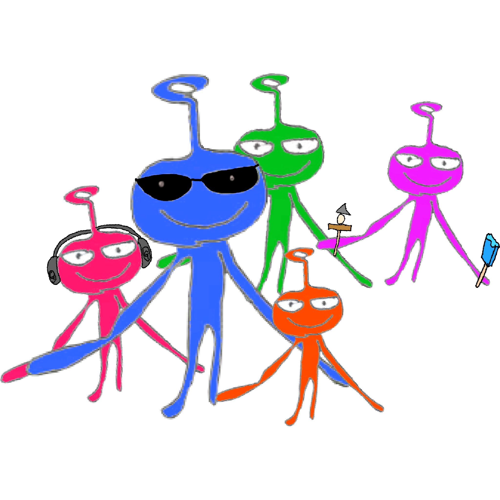
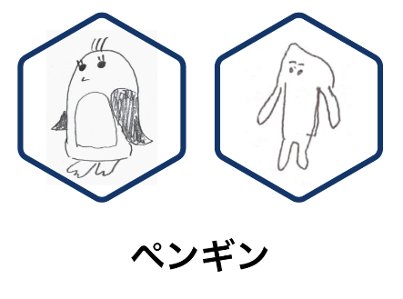
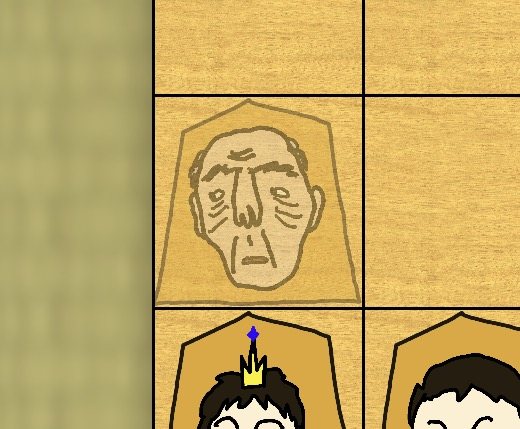
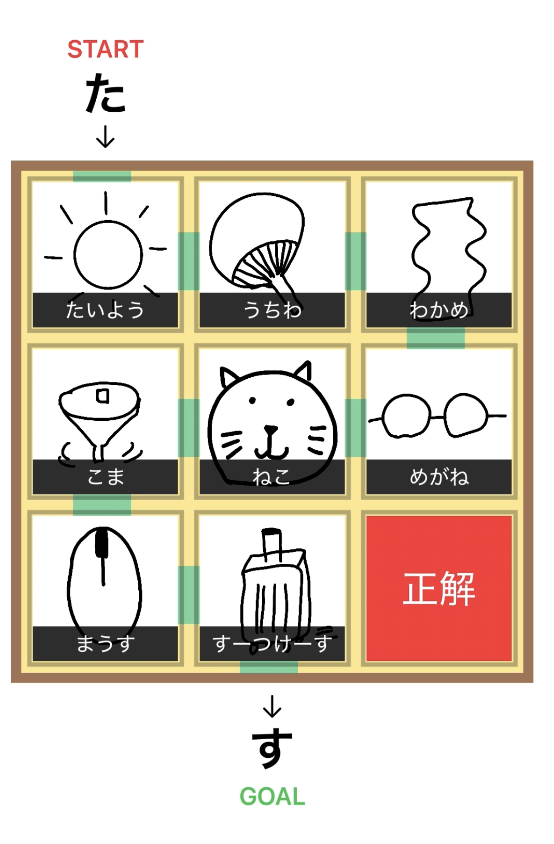

2026年9月にリリースしたアプリ、「ガメニのひまつぶし」。
[noteでも紹介しましたが](https://note.com/web800/n/n9d5774c576c7) 、こちらではより詳しく紹介します。

[特設サイトはこちら](/works/gameni)

## 概要

「ガメニのひまつぶし」には、いくつかの変わったミニゲーム（リリース時5つ）が入っています。

「ガメニ」というのは宇宙人の名前。こんなキャラクターです。

アプリ内のいろいろなところに出てきます。探してみてください。

## ミニゲーム紹介

具体的にミニゲームを紹介します。

ミニゲームを増やしたら、この記事も更新する予定ですが、少し時間がかかってしまうかもしれません。気長にお待ちください。

### 理不尽神経衰弱

理不尽神経衰弱は、同じお題で、違う2人が描いた絵を探す神経衰弱です。

しかし、絵を描いた人は開発者とその家族。
全員絵が上手とは限りません。

実際の解答を一つ紹介します。

この2つは両方ペンギンなので正解です。
もっと納得できないような、理不尽な絵が他にも沢山あります。

### ファミリー将棋

ファミリー将棋は、とある家族が駒となった将棋風のゲームです。

その家族は少し困った家族で、弟はたまに勝手に動いてしまうことがあり、お母さんは平和を目指しているため他の駒を取れません。
おじいちゃんはまともですが、少し動くと疲れてしばらく動けなくなります。

普通の将棋なら明らかに詰みの状態でも、相手の弟が勝手に動いて詰みを逃れることもあります。

（疲れたおじいちゃん）

### 絵しりとりパズル

絵しりとりパズルは、スライドパズルと絵しりとりを組み合わせたゲームです。
（1~15までの数字を並び替えたり、絵を完成させるパズル、あれがスライドパズルです。）

このゲームでは、ピースをスライドし、絵しりとりを完成させるとクリアになります。
このゲームでも、絵は開発者の家族が描いたもの。理不尽神経衰弱よりは分かりやすいですが、それでも判別は至難の業です。

（上の画像にある絵は、説明用なので本当には出てきません。）

### おみくじ

その名の通り、運が試されるおみくじ。
このおみくじは、iPhone/iPad本体を振ると引くことができます。
おみくじの内容をよく見ると、他のミニゲームにも影響があるかも？

### UFOクイズ

UFOクイズは、UFOから発射された物の正体を当てるゲーム。

ガメニが乗っているであろうUFOから、なにか物が飛んできます。
その正体を素早く推測するゲームです。

レベルもNormal, Hard, Impossibleと3段階あります。最初はNormalだけが解放されていて、指定の秒数でクリアすると次のレベルが解放されます。

### その他

設定・情報の画面に、謝辞・ライセンス、そしてリスペクトが書いてあります。

このアプリを作るとき、助けになったサイトやアプリ等です。開発者でなくても便利なものもありますので、ぜひ一度ご覧ください。

## 開発について

見た目で分かる人もいると思いますが、開発にはSwiftUIを使っています。
開発期間は4ヶ月くらいです。最初は理不尽神経衰弱を作りました。

ある程度前のiPhoneを使っている人にも対応したかったので、iOS 18から対応しました。
[Appleの集計結果](https://developer.apple.com/jp/support/app-store/)を見ても、iOS 18未満を使っている人は少なそうです。

## ダウンロード

まだダウンロードしていない方は、ぜひダウンロードお願いします！

[ガメニのひまつぶし（App Store）](https://apps.apple.com/jp/app/%E3%82%AC%E3%83%A1%E3%83%8B%E3%81%AE%E3%81%B2%E3%81%BE%E3%81%A4%E3%81%B6%E3%81%97/id6806760737)
